  
  
  

## About me

I'm a fullstack developer based in Metro, Lampung, Indonesia. I build:

- 🌐 **Web apps** with Next.js (App Router), TypeScript and Tailwind CSS
- 📱 **Mobile apps** for Android and iOS with React Native and Expo
- ⚙️ **Backends and APIs** with Laravel and Node.js/Express, on MySQL or PostgreSQL

## Tech stack

  

  
  
  
  

## Featured projects

| Project | Description | Stack |
|---|---|---|
| [**Finance-Apps**](https://github.com/apriprogram/Finance-Apps) | Mobile-first personal finance tracker with budgets, savings goals, debts and reports | Next.js, TypeScript, Tailwind, Zustand, Prisma, Supabase |
| [**E-Voting**](https://github.com/apriprogram/E-Voting) | Web-based voting app for elections, with QR codes | Next.js, TypeScript, Tailwind |
| [**opentools**](https://github.com/apriprogram/opentools) | Privacy-first converter and compressor for video, audio, images and documents | React, Vite, Express, FFmpeg |
| [**lapakagum**](https://github.com/apriprogram/lapakagum) | Store management dashboard for a fish and shrimp shop, with Excel/PDF reports | Next.js, Prisma, NextAuth, Recharts |
| [**kantorhukumvonniamelda**](https://github.com/apriprogram/kantorhukumvonniamelda) | Website for a law office | Laravel, Tailwind CSS |
| [**digitalinvitation**](https://github.com/apriprogram/digitalinvitation) | Digital wedding invitation with an admin panel | Node.js, Express, MySQL |

## Let's work together

Need a website, web app or mobile app? Reach me through [apriprogram.web.id](https://apriprogram.web.id) or [LinkedIn](https://www.linkedin.com/in/dedeapriyansah/).

